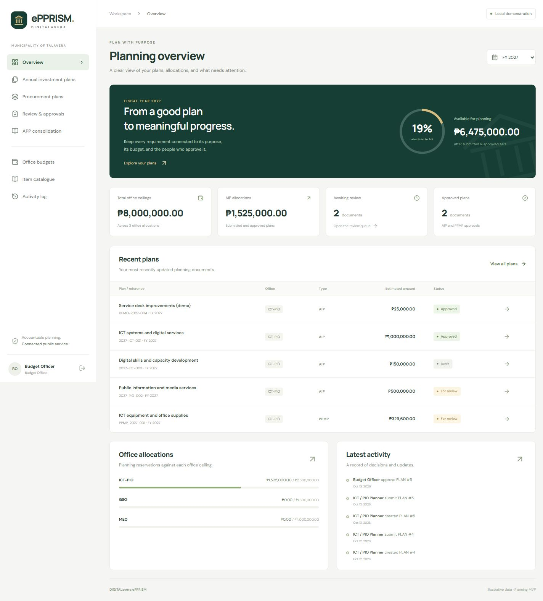

# DIGITALavera ePPRISM

Electronic Planning, Procurement, Resource & Inventory Management System for the Municipality of Talavera.

This repository contains the first working **planning MVP**. It uses Laravel 12 (compatible with the installed PHP 8.2), React 19, TypeScript, Inertia 2, Vite, and locally bundled fonts. SQLite is configured for local development.



## Run locally

The current workspace already has dependencies, a generated application key, migrated SQLite database, sample records, and compiled frontend assets.

```powershell
php artisan serve --host=127.0.0.1 --port=8000
```

Open <http://127.0.0.1:8000>. For live frontend development, run `npm.cmd run dev` in a second terminal. Otherwise, run `npm.cmd run build` after frontend changes. `composer dev` also starts the PHP server using compiled assets.

For a fresh checkout:

```powershell
composer install
npm.cmd ci
Copy-Item .env.example .env
php artisan key:generate
New-Item database/database.sqlite -ItemType File
php artisan migrate
php artisan db:seed
npm.cmd run build
php artisan serve --host=127.0.0.1 --port=8000
```

When using demo data, set `APP_DEMO=true` in `.env` to show the demonstration indicator. The seeder refuses to run outside local/testing and skips databases that already contain users. All seeded amounts and prices are illustrative; **the supplied Excel workbook has not been imported**. Do not use demo accounts or the PHP development server for production.

## Local demonstration accounts

All demo accounts use the password **`Talavera2027!`**.

| Email | Role |
| --- | --- |
| office@epprism.test | ICT/PIO planner: create, edit, submit own office plans |
| budget@epprism.test | Assign office ceilings and review AIPs |
| mayor@epprism.test | Review PPMPs and approve consolidated APP batches |
| procurement@epprism.test | Consolidate approved PPMPs into an APP |
| gso@epprism.test | Maintain catalogue items and prices |
| inventory@epprism.test | Read planning records; inventory transactions are a later phase |
| admin@epprism.test | Create accounts/offices, manage catalogue and drafts; no financial approval override |

## What works

- Session login/logout with CSRF protection and login throttling.
- Responsive dashboard, fiscal-year views, searchable/filterable plans, and paginated lists.
- Office budget creation/adjustment, with reasons captured in the audit log.
- Catalogue creation/editing, deactivation, specifications, expense classes, and prices.
- AIP activities with office, fiscal year, fund source, implementation dates, outputs, and PS/MOOE/FE/CO allocations.
- PPMP requirements linked to approved AIPs, with 12 monthly quantities, quarterly summaries, server-computed totals, and saved item/price snapshots.
- AIP review by Budget; PPMP review by the Approving Authority. Reviewers can approve or return for revision with a required reason.
- Read-only approved records, stale-edit detection, office isolation, and audit history.
- Basic APP batching of approved PPMPs, with one-time assignment and mayor approval.
- CSV exports and browser-printable plan detail pages. These are planning summaries, not certified government form replicas.
- Office and user creation by administrators.

## Try the workflow

1. Log in as the office planner. The demo contains an approved AIP, a pending AIP, a draft AIP, and a pending PPMP.
2. Create an AIP and save it. Submit it for review.
3. Sign out and log in as Budget. Open the review queue and approve it, or return it with a comment.
4. As the office planner, create a PPMP and select the approved AIP. Add catalogue items and monthly quantities. Save and submit.
5. As Mayor, review and approve the PPMP.
6. As Procurement, select approved PPMPs under APP consolidation and submit a batch.
7. As Mayor, approve that APP. Inspect document history and the activity log to follow the decisions.

The browser smoke test also leaves a clearly labeled `DEMO-2027-004` AIP in the local database.

## Budget and data rules

- All monetary values are stored as integer centavos. Input conversion uses BCMath. The server computes PPMP totals; client-supplied totals and prices are ignored.
- Draft and returned AIPs do not reserve the office ceiling. Submitted and approved AIPs do. A return releases the planning reservation.
- PPMP submission checks MOOE and CO separately against its approved parent AIP, including other submitted/approved PPMPs. It does not deduct the office ceiling again.
- Catalogue changes never rewrite existing saved PPMP lines. Editing and saving a draft refreshes its prices from the active catalogue, as disclosed in the form.
- Budget reductions below existing planning reservations are rejected.
- Submissions serialize through an office/year budget row; optimistic document versions reject stale edits and review actions.
- Transactions wrap state changes and audit events. There are no UI/API routes for editing audit events.
- Approved documents cannot be amended yet. Formal immutable revision snapshots and amendment approval are a later milestone.
- APP batching preserves the PPMP linkage. Procurement packaging, APP returns/amendments, and official APP exports are not implemented yet.
- Budgets here are planning ceilings and allocations, not an obligation, disbursement, or general ledger.

## Tests and build

```powershell
php artisan test --compact
npm.cmd run build
php vendor/bin/pint --test
npm.cmd run typecheck
```

The feature suite uses an isolated in-memory SQLite database. It covers login, office boundaries, role checks, budget oversubscription, returned-plan release, immutable approvals, stale edits, server-side totals, item price history, monthly quantity validation, APP duplicate assignment, CSV formula injection, and main-page rendering.

Initial verification: **17 tests passed, 107 assertions**, TypeScript and production build passed, and PHP formatting passed. Browser checks exercised office login, AIP creation/submission, Budget review/approval, locked approved records, and the mobile dashboard. See [approval demonstration](docs/images/approval-demo.jpg). GitHub Actions repeats the build, tests, and PHP formatting checks on pushes and pull requests.

For a production pilot, run the same suite and true parallel submission tests on the chosen production database. SQLite development tests do not establish PostgreSQL/MySQL concurrency behavior.

## Project layout

- `app/Services/PlanningService.php`: monetary calculations, reservations, document transitions, audit creation.
- `app/Services/PlanningAccess.php`: role and office access checks.
- `app/Http/Controllers`: authentication, plans, budgets/catalogue/administration, APP consolidation.
- `app/Models` and `database/migrations`: normalized planning records and constraints.
- `resources/js/pages`: React screens, served through Inertia.
- `resources/css/app.css`: responsive application styling.
- `tests/Feature/PlanningWorkflowTest.php`: business workflow and access tests.
- `docs/ROADMAP.md`: remaining product milestones and decisions.

## Production preparation

Confirm signatories and approval routing with the responsible offices. Provision a separate database with real accounts, use HTTPS and private server configuration, set `APP_DEBUG=false`, `APP_DEMO=false`, and secure cookies, and serve only Laravel's `public` directory. Test backups/restoration, concurrency, access permissions, and deployment monitoring before a pilot. Account deactivation/reset, MFA, formal document templates, and amendment handling remain required follow-up work.
